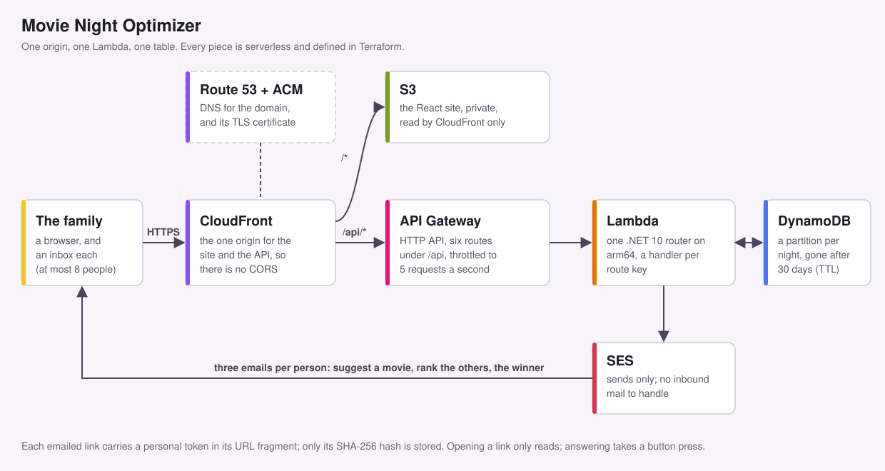

# Movie Night Optimizer

[](https://github.com/OsborneSupremacy/movie-night-optimizer/actions/workflows/ci.yml)

Picks the movie for a group that can't agree on one.

An organizer enters everyone's email address and the date. Everyone is emailed a link to suggest
one movie. Once every suggestion is in, everyone is emailed again to rank the suggestions, except
their own. Once every ranking is in, everyone is emailed the result.


## How it works

A night moves through three phases and only ever forwards:

| Phase        | What's happening                                                      |
|--------------|-----------------------------------------------------------------------|
| `Collecting` | Everyone suggests one movie.                                          |
| `Ranking`    | Everyone ranks the suggestions that aren't theirs, best first.        |
| `Done`       | The rankings are scored and the results are sent.                     |

There are no accounts. Each participant's emailed link carries a token that is theirs alone, in
the URL fragment, and only the token's hash is stored. Because a stored hash can't be turned back
into a link, each round's email carries a new token, added alongside the old ones, so every link a
person has been sent keeps working. Opening a link only reads; suggesting and
ranking happen when a person presses a button, so a mail scanner that follows a link can't answer
for anybody.

Scoring is a Borda count: on a ballot ranking k movies the first gets k points and the last
gets 1. Ties go to the movie with more first-place votes.

A round closes when the last person answers, or when the organizer closes it early so one person
can't stall the night. If only one movie was suggested, the night skips ranking and goes straight
to the result. The phase change is conditional on the phase the night was read in, so two people
finishing at the same moment can't both send the next round of email.

Creating a night mails addresses a stranger typed, from an SES account other applications share,
so there are limits. One inbox can start at most three nights a day, and the whole app at most 50.
Every email has a link to stop email for good. That adds a hash of the inbox to a do-not-email list,
which is checked before every send, and takes the person out of their night so no round waits on
them.

Each movie can only be suggested once. A second person suggesting the same title is asked for
another pick, because two entries would split the movie's votes. Titles match ignoring case,
punctuation and a leading "The".

## How it's built

| Layer          | Built with                                                                                     |
|----------------|------------------------------------------------------------------------------------------------|
| Frontend       | React + TypeScript on Vite, served from S3 behind CloudFront.                                   |
| API            | .NET 10 on AWS Lambda behind an API Gateway HTTP API. One router Lambda dispatches on the route key to a keyed handler. |
| Data           | DynamoDB, one partition per night, removed by TTL after 30 days.                                |
| Email          | SES, sending only.                                                                              |
| Infrastructure | Terraform.                                                                                      |

The site and the API share one origin, `movienight.osbornesupremacy.com`. CloudFront sends
`/api/*` to API Gateway and everything else to S3, so there is no CORS to configure.



### Repository layout

| Path                           | What's in it                                                   |
|--------------------------------|----------------------------------------------------------------|
| `src/MovieNight.Library`       | All application code: router, handlers, providers, scoring.    |
| `src/MovieNight.Library.Tests` | Unit tests.                                                    |
| `src/app`                      | The React frontend.                                            |
| `iac/terraform`                | Everything in AWS.                                             |
| `scripts`                      | Build and deploy scripts.                                      |

### API

| Route                                   | What it does                                          |
|-----------------------------------------|-------------------------------------------------------|
| `GET /api/health`                       | Answers 200 without touching anything else.           |
| `POST /api/nights`                      | Creates a night and sends the suggestion emails.      |
| `GET /api/nights/{nightId}`             | What this participant should see right now.           |
| `POST /api/nights/{nightId}/suggestion` | Records this participant's movie.                     |
| `POST /api/nights/{nightId}/ranking`    | Records this participant's ranking.                   |
| `POST /api/nights/{nightId}/advance`    | Organizer only: closes the current round early.       |
| `POST /api/nights/{nightId}/opt-out`    | Never email this participant's inbox again.           |

Every route but the first two identifies the caller by the `X-Participant-Token` header.

## Deploying

Needs dotnet 10, Terraform, Node and the AWS CLI, with credentials for the account.

```bash
./scripts/deploy.sh
```

That builds the Lambda, applies Terraform, builds the site, syncs it to S3 and invalidates
CloudFront. The first apply takes a while: it waits on certificate validation, SES domain
verification and a new CloudFront distribution.

Then:

```bash
curl https://movienight.osbornesupremacy.com/api/health
```

## Tests

```bash
dotnet test
```

## Status

- [x] Infrastructure: DynamoDB, Lambda, HTTP API, S3, CloudFront, certificate, DNS, SES identity
- [x] Router, request adapter, token hashing
- [x] Borda scoring, with tests
- [x] Reading and creating a night in DynamoDB
- [x] `POST /api/nights`, with a per-organizer daily limit
- [x] `GET /api/nights/{nightId}`
- [x] Suggesting, ranking and closing a round early
- [x] The three emails
- [x] Suggest, rank and results pages
- [x] Turning away a movie somebody else already suggested
- [x] CI: build, tests and Terraform checks on every push
- [x] An app-wide daily cap, and a do-not-email list with a link in every email
