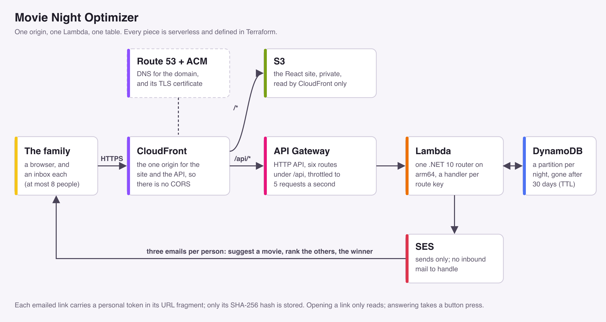

# Movie Night Optimizer: submission draft

A draft for the challenge write-up and the demo video. Edit freely; nothing here is final.

## The problem

Every family movie night starts with the same twenty minutes: someone suggests a movie, someone else has seen it, a third person wants something lighter, and whoever argues longest wins. The people who don't argue never get a say, and by the time a movie is chosen half the evening is gone.

## How Movie Night Optimizer solves it

The organizer enters everyone's email address and the date. That's the only setup: no accounts, no app to install.

1. **Everyone suggests one movie.** Each person gets an email with their own link and suggests a movie on a simple page. Nobody sees the others' picks until they've made their own, so nobody anchors on the first suggestion.
2. **Everyone ranks the others.** When the last suggestion is in, everyone gets a second email and puts the other suggestions in order, best first. Nobody ranks their own movie, so nobody can vote it to the top.
3. **The results arrive.** When the last ranking is in, the rankings are scored with a Borda count and everyone is emailed the winner and the full order. Ties go to the movie more people ranked first.

If someone never answers, the organizer can close the round and move on, so one person can't stall the night.

## AWS services and how they connect

- **Amazon CloudFront** is the single front door, at `movienight.osbornesupremacy.com`. It serves the site from S3 and sends `/api/*` to API Gateway. With one origin for both, the browser never makes a cross-origin request, so there's no CORS to configure. A response headers policy adds HSTS, a strict content security policy and protection against being framed by other sites.
- **Amazon S3** holds the React front end. The bucket is private and readable only by CloudFront, through origin access control.
- **Amazon API Gateway (HTTP API)** exposes six routes under `/api`, throttled to 5 requests a second.
- **AWS Lambda** runs one .NET 10 function on arm64. It dispatches each request on its route key to the handler for that route, so one small deployment serves the whole API. It is compiled ahead of time (ReadyToRun) and given one full vCPU, which brought the first request after an idle spell from 1.8 s to 0.7 s. Warm requests take milliseconds.
- **Amazon DynamoDB** stores each night in a partition of its own: a summary item plus one item per person, so one query reads the whole night. A TTL deletes nights after 30 days, and on-demand billing means an idle app costs almost nothing.
- **Amazon SES** sends the three emails, with HTML and plain-text versions. The domain is verified with DKIM, SPF and DMARC records.
- **Amazon Route 53 and AWS Certificate Manager** provide the domain and its TLS certificate.
- **Terraform** defines every resource above, and one script builds and deploys the whole app.
- **GitHub Actions** builds and tests the API, builds the front end, and checks the Terraform on every push.

## Design decisions worth calling out

- **Opening a link never changes anything.** Corporate mail scanners follow every link in an email. If opening a link recorded an answer, a scanner could vote for someone. Every link only reads; answering takes a button press.
- **No accounts, and no stored secrets.** Each person's link carries a random 256-bit token in the URL fragment, which browsers never send to servers, so it stays out of access logs. The API receives the token in a header, and only its SHA-256 hash is stored. Each round's email carries a fresh token, so every link anyone has been sent keeps working.
- **Exactly one round of email, even under a race.** The last two people often answer at almost the same moment. Every write is a DynamoDB transaction conditional on the night's current phase, and the phase moves on only from the phase it was read in. However the requests interleave, only one of them moves the night on and sends the next email.
- **Abuse limits on a public endpoint.** Creating a night sends mail to addresses a stranger typed, so each inbox can start at most three nights a day, with at most eight people per night. Address variants like `me+1@gmail.com` count as the same inbox.
- **Fair scoring.** A Borda count is only fair if every ballot ranks the same number of movies, so a ranking must include every other movie exactly once.
- **One entry per movie.** If two people suggest the same movie, its votes would be split between two entries. Merging the entries would leave that movie off two ballots instead of one, which breaks the fairness above. So the second person is told "Great minds! Someone already suggested that one" and asked for another pick. Titles match ignoring case, punctuation and a leading "The", so "princess bride!" is caught. Only that one title is revealed, so nobody anchors on the others' picks.

## Demo video script (target 2:45, limit 3:00)

Filmed in live mode with `@osbornesupremacy.com` addresses, which all reach one inbox. Give each family member an obvious name (`grandma@`, `sam@`, `alex@`), so each email's To line shows whose link it is.

Each inbox can start only three nights a day, and rehearsals count. Use a different organizer address for each take (`organizer1@`, `organizer2@`…). Different names before the @ are separate inboxes; only `+tag` variants count as the same one.

The first request after the site has been idle takes about a second, so click through once before you start recording.

| Time | On screen | Say |
|---|---|---|
| 0:00–0:15 | Title card, then the home page | The problem: twenty minutes of arguing, and the quiet people never get a say. |
| 0:15–0:35 | Fill in the organizer's address, three family addresses, the date. Send. | No accounts, nothing to install. Just the emails and a date. |
| 0:35–0:55 | The inbox: four "Pick a movie" emails, one to each person. Point at the To lines, then open the organizer's. | Everyone gets their own link. Opening it only reads; answering takes a button. |
| 0:55–1:30 | Suggest a movie as each person, sped up after the first. Have one person try a movie already picked, to show "Great minds!". Leave the organizer's page open; after the last suggestion it switches to ranking on its own. | Nobody sees the others' picks until they've made their own, and each movie can only be suggested once. |
| 1:30–2:00 | Open a "Rank the movies" email. Drag the list into order, show that their own movie isn't on it, and submit. Sped-up cut through the rest. | You rank everyone else's movie, never your own. |
| 2:00–2:15 | The results page and the results email. | Borda count. Ties go to more first-place votes. |
| 2:15–2:40 | The architecture diagram. | CloudFront in front of S3 and an HTTP API, one Lambda, DynamoDB, SES. All serverless, all Terraform. |
| 2:40–2:50 | Optionally, the organizer's "close this round" button. | One person can't stall the night. |
| 2:50–3:00 | The site URL. | |

## Before submitting

- Swap in the video link.
- Optionally, link the repository: the README covers the design, and the CI badge shows the build passing.
